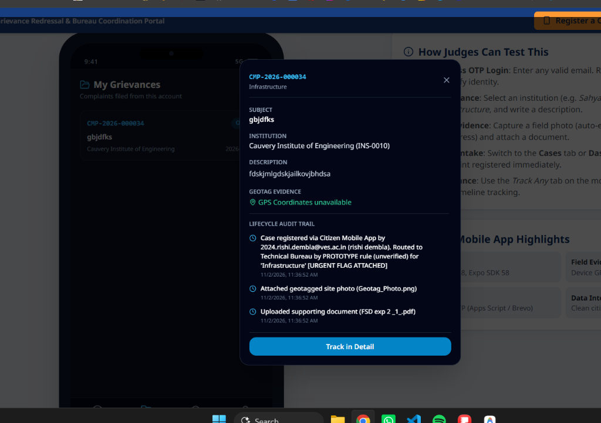
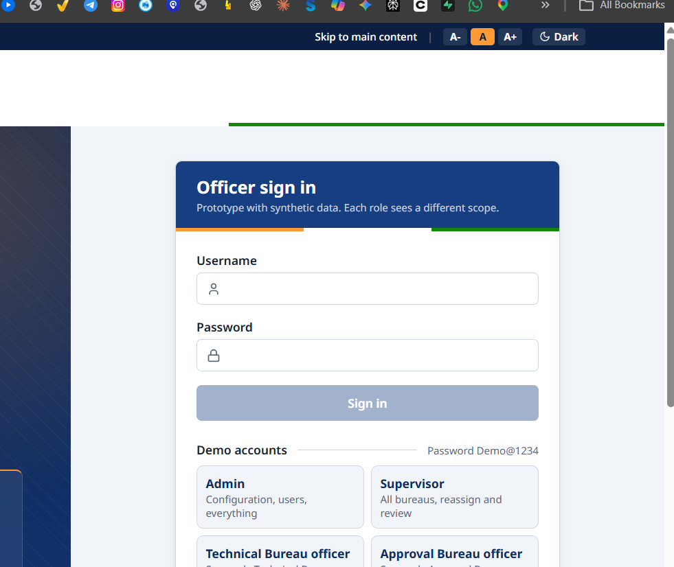
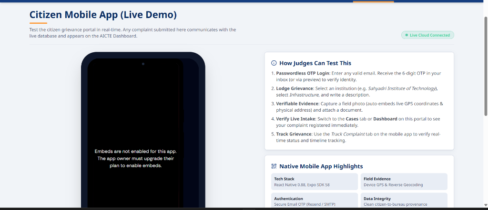
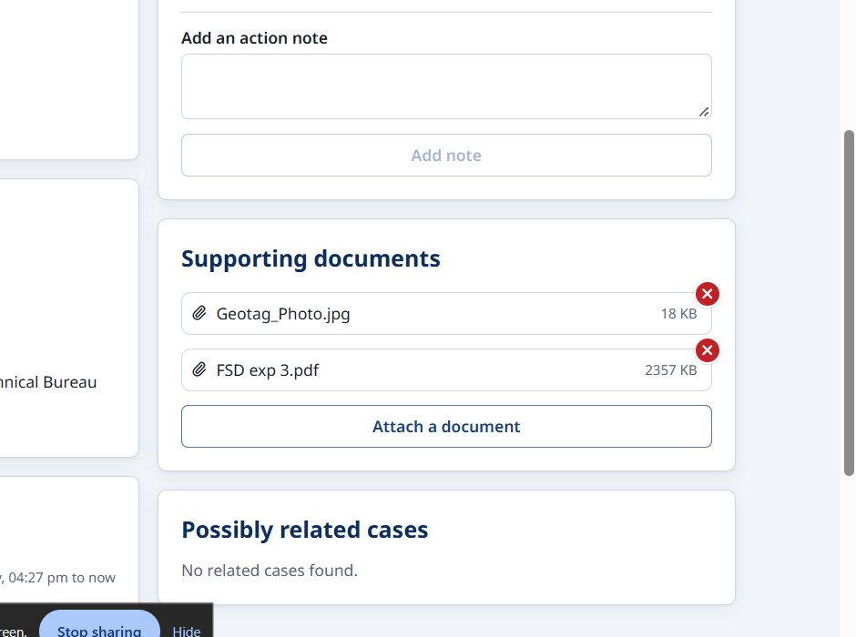

# AICTE Integrated Complaint Monitoring & Coordination Platform (PS 26264)

An end-to-end, institution-wise grievance redressal and complaint monitoring platform across AICTE bureaus and cells. Features role-based officer access, configurable routing rules, explainable duplicate/overlap detection, deadline tracking with SLA escalation, audit trails, analytics dashboards, and an integrated multilingual citizen mobile application with geotagged evidence capture.

> **Note**: All demonstration data is synthetic and designed for prototype evaluation.

---

## 📸 Application UI Gallery

### 1. Officer Monitoring & Coordination Dashboard
Full bureau-level visibility into open cases, SLA deadlines, overdue escalations, and automated review queues.


### 2. Citizen Mobile Grievance Portal (Live In-Browser Demo & Expo App)
Citizens and students can seamlessly lodge complaints, search AICTE-approved institutions, and track grievances in real-time. Includes full 3-language support (**English**, **हिंदी**, and **मराठी**).


### 3. Passwordless Email OTP Verification
Secure identity verification using one-time verification codes sent via email, with instant dev preview fallback for presentations.


### 4. Geotagged Field Evidence & In-Portal Document Previewer
Officers can view reverse-geocoded location addresses, GPS coordinates with one-click Google Maps navigation, captured site photos with watermarks, and preview supporting PDFs/documents directly in the portal.


---

## 🌟 Key Platform Capabilities

| Capability | Description |
|---|---|
| **Unified Portal Entry** | Quick navbar access to both Officer Sign-In and Citizen Grievance Portal. |
| **Multilingual Citizen App** | Native support for English (default), Hindi (हिंदी), and Marathi (मराठी). |
| **Geotagged Evidence Capture** | Laptop webcam or smartphone camera integration with auto-embedded timestamps and live GPS coordinates. |
| **Document Previewer** | Instant inline viewer for PDFs and image attachments directly in the officer console. |
| **Intelligent Case Routing** | Rules engine automatically assigns incoming grievances to the appropriate AICTE bureau. |
| **Overlap & Duplicate Detection** | Natural language processing (TF-IDF + semantic embeddings) flags related or duplicate complaints across institutions. |
| **SLA Tracking & Escalations** | Color-coded deadline status (`On Track`, `Due Soon`, `Overdue`, `Escalated`) with automated supervisor alerts. |
| **Fast Cloud Response & Keep-Alive** | Built-in in-memory configuration caching, joined database queries, and automatic background pre-warming. |

---

## 🛠️ Technology Stack

| Layer | Technologies |
|---|---|
| **Web Frontend** | React 18, React Router 6, Tailwind CSS 3, Recharts, Lucide Icons, Vite |
| **Mobile Application** | React Native, Expo SDK 58, Expo Location, HTML5 Webcam / Geolocation API |
| **Backend API** | Python 3.10+, FastAPI, Pydantic v2, SQLAlchemy 2, Passlib (bcrypt), JWT |
| **Database** | SQLite (development) / PostgreSQL 16 (production) |
| **Email Delivery** | SMTP / Gmail App Passwords / Resend API |
| **Duplicate Detection** | Rule Engine + TF-IDF Vectorizer + Multilingual Sentence Transformers |

---

## 🚀 Quick Start Guide

### Prerequisites
- **Python 3.10+**
- **Node.js 18+** and **npm**
- *(Optional)* **Expo Go** on mobile for physical device testing

### 1. Clone Repository
```bash
git clone https://github.com/Jagdale-Siddharth/CaseGrid.git
cd CaseGrid
```

### 2. Backend Setup
```powershell
cd backend
python -m venv .venv

# Windows PowerShell:
.\.venv\Scripts\Activate.ps1
# Mac / Linux:
# source .venv/bin/activate

pip install -r requirements.txt
copy .env.example .env          # Mac/Linux: cp .env.example .env

# Initialize synthetic database and seed data:
python -m app.seed --reset

# Run backend API server:
uvicorn app.main:app --host 0.0.0.0 --port 8000 --reload --reload-dir app
```
- API Swagger Documentation: [http://localhost:8000/docs](http://localhost:8000/docs)

### 3. Frontend Dashboard Setup
```bash
cd frontend
npm install
npm run dev
```
- Open [http://localhost:5173](http://localhost:5173) in your browser.

---

## 👥 Demo Officer Accounts

All demo accounts use password: `Demo@1234`

| Username | Role | Scope |
|---|---|---|
| `admin` | Admin | Full platform administration, routing rules, configuration, and user management |
| `supervisor` | Supervisor | Cross-bureau oversight, case reassignment, and supervisor escalation review |
| `kulkarni` | Officer | Technical Bureau cases and evaluations |
| `deshmukh` | Officer | Approval Bureau cases and institutional reviews |
| `iyer` | Officer | Student Grievance Cell cases and student welfare matters |
| `management` | Management | High-level analytics, compliance reports, and CSV/PDF data exports |

---

## 📱 Mobile Grievance Testing

1. Navigate to the **Register a Complaint** tab on the main navbar.
2. Enter any valid email (e.g. `student@example.edu`) to receive a 6-digit OTP (or use the instant preview code).
3. Select an AICTE-approved institution from the searchable database.
4. Pick a grievance category, enter a subject, and write your description.
5. Capture a geotagged photo via laptop webcam/camera and attach supporting documents.
6. Submit and track the assigned **Case ID** (`CMP-YYYY-XXXXXX`) in real time across the portal!

---

## 🧪 Testing & Linting

```bash
# Run root linting (Frontend ESLint + Backend Flake8):
npm run lint

# Run frontend build verification:
npm --prefix frontend run build

# Run backend test suite:
cd backend
pytest
```

---

## 📄 License
Developed for AICTE Complaint Monitoring & Redressal Coordination. Synthetic demo prototype for technical review.
